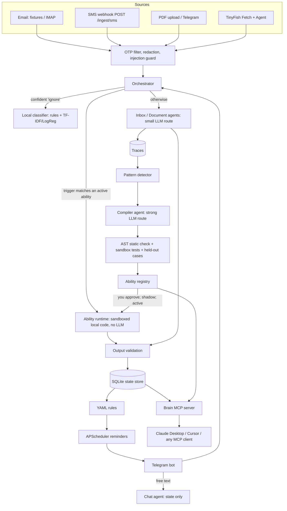
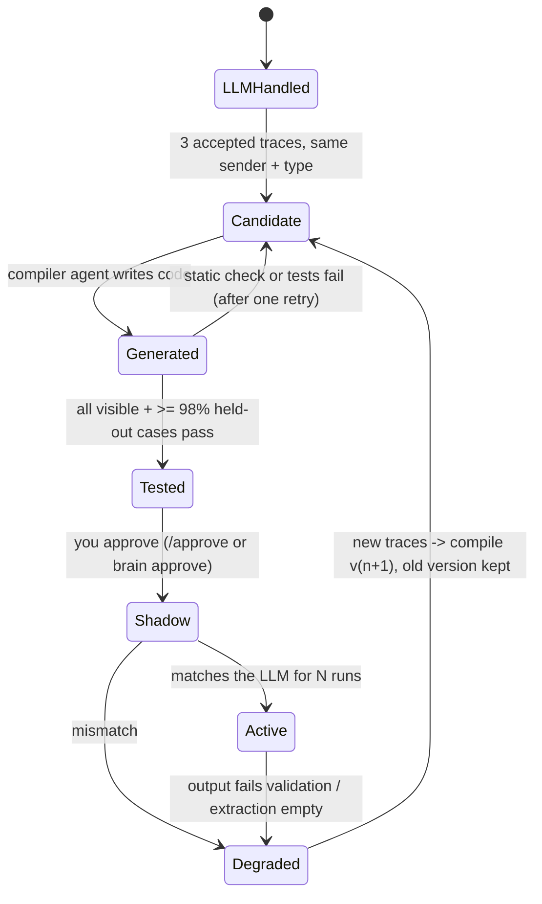

# Sorted

**A household admin assistant that uses AI as a compiler, not an interpreter.** It learns a task with an LLM,
then writes, tests and switches to its own local code, so it gets cheaper, faster and more private every month.

*AzinHack 2026 · Team Not Found: Anish Manchanda, Aryan Thakur, Keshav Goel*

## The problem

In an Indian household, one person usually keeps track of everything: credit card bills, BSES/electricity,
broadband, LIC premiums, car insurance renewals, Netflix price hikes, Mom's thyroid tablets, the PUC certificate.
The information is spread across email, SMS, PDFs and memory, and each app sees only one slice. Things slip.

A typical "AI assistant" fixes this by sending every email to an LLM, every time. That is slow, costs money on
every message and sends your bank statements to a model provider forever.

Sorted uses the LLM only while a task is **new**. Every LLM solve is saved as a trace. When the same kind of
message repeats (3 times by default), a compiler agent writes a small Python parser plus tests from those traces.
The parser is checked, tested in a sandbox against held-out cases, approved by you, run in shadow next to the LLM,
and then takes over with **zero LLM calls**. If a bank changes its email layout, validation fails, Sorted falls
back to the LLM, collects new traces and compiles **version 2**. Everything is queryable from Claude Desktop or
Cursor through an MCP server.

## Results (real numbers, from `make demo` and `make eval`)

`make demo` replays 6 simulated months of synthetic bills in seconds to show how the share of local code grows;
no real user data or history.

The simulation uses one persistent, committed synthetic dataset ([`data/samples/`](data/samples)): 81 messages (59 emails, 19 SMS, 3 PDFs) labelled "Sim month 1-6". Its simulated
timeline ends on 23 Oct 2026 (`make dataset` regenerates it to end today). It runs in its own database
(`data/demo.db`), separate from the live bot's database. Every figure below is copied from
[`reports/demo_run.md`](reports/demo_run.md) and [`reports/eval.md`](reports/eval.md).

| period | messages | handled by local code | LLM calls | tokens | privacy score | cost / message (USD, est.) |
|---|---|---|---|---|---|---|
| Sim month 1 | 10 | 0 | 10 | 14,009 | 0% | 0.00063 |
| Sim month 2 | 12 | 0 | 12 | 16,101 | 0% | 0.00060 |
| Sim month 3 | 15 | 1 | 23 | 28,663 | 7% | 0.00556 |
| Sim month 4 | 12 | 0 | 13 | 20,334 | 0% | 0.00249 |
| Sim month 5 | 13 | 8 | 7 | 12,944 | **62%** | 0.00252 |
| Sim month 6 | 15 | 7 | 9 | 13,499 | **47%** | 0.00115 |

- **Sim month 3:** 8 parsers compiled and passed their tests. Its LLM calls include the compiler agent, so its
  cost per message is the highest. Sim month 4 is the shadow month, where compiled code runs next to the LLM and
  the LLM's answer is still used.
- **The Apollo Clinic parser:** failed its tests in Sim months 3, 4 and 5. It stayed a candidate, with the LLM
  still doing the work, until it passed in Sim month 6 with more examples.
- **Sim month 6:** HDFC redesigns its statement email. `hdfcbank_net_bill_due@v1` fails ("Missing Total Amount
  Due"), and the message falls back to the LLM. v2 compiles from the old cases plus the new layout and passes.
  Sim month 6 also has the new meeting requests and a one-off dentist email, which the LLM handles. That is why
  its local share is lower than Sim month 5's.
- **Compiled code:** 11 parser versions, each passing all visible tests and 100% of its held-out cases. The code
  is in [`abilities/`](abilities). `uv run pytest abilities` runs their 37 generated tests.
- **Extraction accuracy** across all 77 non-OTP samples: 100% on type, provider and due date; 98.6% on amount
  (the LLM got 53 of 54 amounts right; compiled code got 15 of 15). The data is synthetic and template-generated, so real inboxes will be
  harder.
- **Local ML classifier** (TF-IDF + logistic regression, held-out): 88.7% accuracy over 5 stratified 70/30
  splits. 82.6% of predictions clear the 0.7 confidence threshold, and those are 100% correct; everything below
  the threshold goes to the LLM.
- **No-LLM scheduling and rules:**
  - 32 reminders fired on time from templates.
  - 3 price-increase alerts (Spotify, Netflix, YouTube).
  - 4 meeting requests turned into "add it to your calendar?" prompts.
- **Safety:** the prompt-injection email never reaches an LLM. OTP SMS are dropped before storage.
- 60 offline tests (`make test`).

## Quickstart

**Step-by-step demo guide (dashboard + Telegram): [DEMO.md](DEMO.md).**

Python 3.12 and [uv](https://docs.astral.sh/uv/) required.

```bash
git clone <this repo> && cd sorted
make setup      # installs deps, creates .env from .env.example, creates the SQLite DB
make demo       # 6 simulated months of synthetic bills -> reports/demo_run.md (data/demo.db; no key)
make eval       # re-score the last demo: accuracy per handler + classifier held-out -> reports/eval.md
make test       # 57 offline tests (LLM and TinyFish mocked)
```

`make demo` replays the LLM responses recorded in [`data/llm_cache/`](data/llm_cache) during our live run,
so it needs no key. To run against live models, put `OPENAI_API_KEY`
and/or `CEREBRAS_API_KEY` in `.env` (optionally `TINYFISH_API_KEY`) and run `make demo-live`. Either key alone
works: each route falls back to the other provider.

Other entry points:

```bash
uv run brain ingest data/samples/email/m1_bses.eml   # any .eml or .pdf through the pipeline
uv run brain say "Track Mom's thyroid tablet, 1 every morning, 30 left"
uv run brain due              # what's due in the next 7 days (no LLM)
uv run brain ask "When does my car insurance expire?"
uv run brain abilities        # compiled abilities + health
uv run brain approve <name>   # human gate: tested -> shadow
uv run brain score            # your privacy score (live DB); --demo for the simulation
uv run brain fetch <url>      # TinyFish Fetch a page into the pipeline
uv run brain portal <url> "<goal>"   # TinyFish Agent (replays unless TINYFISH_LIVE=1)
uv run brain imap --since 2026-10-01 # read-only IMAP (Gmail app password)
make bot        # Telegram bot + scheduler
make mcp        # Brain MCP server over stdio
```

## Interactive simulation: web dashboard + Telegram

```bash
make sim
```

**One command:** send `/run` to the bot, or press **▶ Run full demo**. It plays all six Sim months on autopilot,
one event every few seconds, with a chapter and a recap per month, saying yes to every approval, new skill,
meeting and reply (see [DEMO.md](DEMO.md)).

This opens a dashboard at http://127.0.0.1:8000. If `TELEGRAM_BOT_TOKEN` is set, the same simulation also runs
through your Telegram bot; stop `make bot` first, because one token allows only one bot connection. You play
Rohan Sharma, the person the synthetic data belongs to, and move a simulated clock:

| Control | Effect |
|---|---|
| Next event, +1 day, +1 week, to month end, run to today | Dashboard buttons. In Telegram: `/next`, `/day`, `/week`, `/month`, `/end` |
| Auto-play | Steps through events every few seconds |
| Auto-approve (demo) | Approves each ability as soon as it passes its tests. Off: you approve each one yourself |

As the clock moves:

- **Mail arrives** through the real pipeline. The live feed shows each message with how it was handled:
  `LLM`, `compiled code`, `local ML`, `rule`, or `dropped before storage`.
- **Reminders fire on simulated time** with no AI: "HDFC Bank bill ₹13,903.23 is due on 16 Oct. Reply 'paid'…".
- **Meeting requests:** "📅 Meeting request from Ravi Kumar (Acme Infra) · They proposed: Thu 29 Oct, 11:00 AM ·
  Do you want to meet?" comes with three buttons: the proposed slot, **Another time** (then type e.g. "Friday
  5pm"; a date parser reads it, no AI), or **Decline**. Booking schedules reminders for the day before and the
  hour before and gives you a Google Meet link, a prefilled Google Calendar link and an `.ics` file. Sorted then
  drafts a reply to the person ("Friday 30 October at 5:00 PM works for me… Google Meet: …") and sends it **only
  if you press Send**. Limits: there is no mail server, so "sent" means it lands in the dashboard's outbox, and
  the Meet link is a placeholder in Meet's format until a Google Calendar API connection creates real ones.
- **New kinds of messages become new skills.** When no known type fits, the extractor labels a message `other`
  with a category it invents (e.g. `shipment_request`). After 3 of the same category, Sorted notices it on its
  own and asks: "🆕 New kind of message: Shipment requests… Learn this skill?" One LLM call plans the skill from a
  fixed, safe action set (remind you before each one's date, message you on arrival, or just track them). If you
  agree, the compiler writes and sandbox-tests a parser for those messages, which goes through the usual approve →
  shadow → active path, and every later one triggers the skill's action with no AI.
- **Questions over a date range:** "give me all my dues and updates between 1 June and 15 July" returns a digest
  of bills due, appointments, requests and every update received in that window. The LLM maps it to
  `{intent: digest, period: range, start, end}`, and fixed code builds the answer. Repeated digest questions get
  compiled like any other question type.
- **Approvals:** at each Sim month end the compiler runs, and every ability that passes its tests asks for your
  approval with a button.
- **Chat questions get compiled too.** Ask "Do I have any doctor appointments this month?":
  - The LLM turns the question into a typed query, `{intent: appointments, period: this_month}`. Fixed read-only
    code runs it and fills a template answer.
  - Ask the same *kind* of question 3 times, and the compiler writes a small recogniser, `query_appointments`.
    The sandbox tests it on your past questions, plus other questions it must *not* claim. You approve it, it
    shadows the LLM, and then those questions are answered with **0 LLM calls**.
  - A phrasing it doesn't recognise goes to the LLM. Repeated misses, or disagreeing with the LLM, trigger
    version 2.

What the dashboard shows:

- **Month by month:** one card per Sim month that follows the clock: its share of work done by compiled code vs
  the AI, and what was compiled, took over, broke, or was learned that month, plus reminders, meetings and replies.
- **Privacy panel:** the privacy score per Sim month as bars and a table (messages, local code, LLM calls,
  tokens, cost per message), plus the share of chat questions answered by code.
- **"From AI to compiled code":** one card per ability showing its path:
  - LLM solves → compiled + tested (shown and held-out cases) → approved → shadow → active (local runs);
  - a bar showing how much of that task's work is now done by code;
  - the code the AI wrote and its test cases.
- **Synthetic inbox:** every message, with its Sim month, label and delivered/pending status. Click a message
  to see the redacted text the AI and the compiled code actually see. You can add your own synthetic emails or
  SMS (templates for meeting requests, bills and appointments); they arrive at the current simulated time.
- **Add synthetic data:** describe it ("a supplier sending requests for new shipments sporadically between June
  and August") and one LLM call writes the messages. With no period they spread over the whole timeline.
  Messages dated before the simulated clock arrive at once; the rest arrive as the clock moves. Sorted
  re-assesses after every message, so a new kind of message leads to a skill proposal (above). In Telegram:
  `/generate <description>`.
- **Outbox:** replies you approved, exactly as they would be sent.

Telegram also has `/sim`, `/score`, `/due`, `/abilities`, `/generate` and `/reset`. Free text works as in the dashboard
chat; replies show whether the answer came from the LLM or from compiled code.

## Architecture



The graduation pipeline, as implemented in `brain/compiler/`:



How one message flows:

1. A source adapter turns it into one internal `Message`. OTPs are dropped before anything is stored.
2. The text is redacted (cards keep their last 4 digits; account numbers, phones and emails are masked). Agents,
   compiled abilities and the compiler all see only the redacted text.
3. The orchestrator checks the ability registry. An **active** ability whose trigger matches (sender + subject
   keywords) runs in the sandbox with no LLM. A **shadow** ability runs next to the LLM and is compared with it.
4. Otherwise the local classifier may decide a confident `ignore`. If not, the Inbox or Document agent extracts
   typed fields with the small LLM route, and the run is saved as a trace.
5. Output validation runs (amount > 0, due date in a sensible window, provider present). Failures lower confidence
   and flag the item. Duplicates (the bank's email and its SMS) are linked; conflicts (two premiums for one
   renewal) are flagged, never overwritten. Every fact points at the `source_records` row it came from.
6. YAML rules run (no LLM), and relative reminders are scheduled ("3 days before due").
7. In the background, the detector groups traces and the compiler turns repeats into abilities.

## Role of AI / ML

| Where | What | Model |
|---|---|---|
| Extraction and classification of new message types | Inbox and Document agents, JSON validated by Pydantic, one repair retry | Small route: Cerebras `gpt-oss-120b` (env-configurable) |
| Chat answers | Chat agent answers from a typed state "context pack", never raw email | Small route |
| Requests to the Planner | "Track Mom's thyroid tablet…" parsed once into a medication plus a cron job | Small route |
| Writing code | Compiler agent writes a parser from traces; static check, sandbox tests and held-out cases decide | Strong route: OpenAI `gpt-5.4` |
| Repair | Same compiler, fed the failing new layout + the old cases | Strong route |
| **Local ML** | Two-layer email-type classifier: exact sender/subject rules, then **TF-IDF + LogisticRegression** (scikit-learn), retrained on every LLM-labelled message; below the 0.7 confidence threshold the message goes to the LLM | Runs locally, no network |
| Compiled abilities | Deterministic Python, no AI at run time | None |

`brain/llm.py` is one small wrapper for both providers through the official `openai` SDK (Cerebras is
OpenAI-compatible). It handles JSON mode, Pydantic validation, one retry carrying the validation error, redaction
of every prompt, token and cost logging to `traces`, per-run and per-day token budgets (over budget, the
message is **queued**, not failed; `brain drain` retries it), and record/replay. Model IDs come only from env and
were checked against `client.models.list()` for our keys.

## TinyFish integration

`brain/sources/tinyfish.py` uses the documented REST endpoints with `X-API-Key` (verified against
[docs.tinyfish.ai](https://docs.tinyfish.ai/for-coding-agents.md)):

- **Fetch API** (`POST https://api.fetch.tinyfish.ai`, free): `brain fetch <url>` turns any page (a bill page,
  a public pricing page) into a `web` message that goes through exactly the same pipeline as email: redaction,
  agents, validation, traces, compiler. `--expect-price 649` checks a price-change email against the provider's
  public page.
- **Agent API** (`POST https://agent.tinyfish.ai/v1/automation/run` with `output_schema`, uses credits):
  `brain portal <url> "<goal>"` and Telegram `/portal`. Every run is stored as a `portal` trace, so it can
  graduate like any other task. A result with `amount_due` + `due_date` becomes a bill obligation.
- **Search API** (free): `search()` helper to find a biller's official site.
- Credits: tests never call the Agent API; they mock HTTP. By default (`TINYFISH_LIVE=0`) Agent runs **replay**
  recorded responses from [`tests/fixtures/tinyfish/`](tests/fixtures/tinyfish). We recorded one real run
  (3 steps, 13 s, Netflix's public plans page → `{plan: Standard, price: 19.99, currency: USD}`; TinyFish
  proxies have no India exit, so that page shows US pricing). Steps used are printed when the API reports them.
- With no `TINYFISH_API_KEY`, every call returns a clear "not configured" message, and the demo still runs
  because the Agent step replays.

**Planned: graduation for the web (not built yet).** The same compiler idea applied to portals:

1. **Agent run**: TinyFish Agent solves "get the amount due from this portal" with an output schema (built,
   stored as a trace).
2. **Compile to a script**: after 3 successful runs, the compiler turns the agent's recorded steps into a
   Browser API / Playwright script plus tests.
3. **Replay on schedule**: the scheduler runs that script monthly with no agent and no LLM.
4. **Fall back when the page changes**: script fails validation → one Agent run → recompile v2.

## Telegram bot

```bash
make bot   # needs TELEGRAM_BOT_TOKEN (from @BotFather) in .env
```

The first chat to send `/start` becomes the owner, or set `TELEGRAM_OWNER_ID`. Every other chat is ignored.

- Commands: `/due` (next 7 days, no LLM), `/score` (your real usage; `/score demo` for the simulation), `/abilities`, `/approve <name>`, `/audit`, `/portal <url>`.
- Reply rules, no LLM: `1` / `done` logs a dose and lowers stock (at ≤ 5 left, the `medicine_refill` rule sends
  a refill alert), `snooze 1h`, `paid [provider]`.
- "Track …" / "Remind me …" goes to the Planner, which makes one LLM call. The jobs it creates fire with fixed
  templates and no LLM.
- Other questions go to the Chat agent, which answers from state only. PDFs sent to the bot go to the Document
  agent. Photo OCR is on the roadmap.
- Background jobs in the bot process: reminders (APScheduler, SQLAlchemy job store, survives restarts),
  quiet hours (`BRAIN_QUIET_HOURS=22-07`), reminders due within 15 minutes merged into one message, a nightly
  compile + classifier retrain (it never auto-approves), and IMAP polling when configured.

## Brain MCP server (Claude Desktop, Cursor)

Built on the official MCP Python SDK (v2, `MCPServer`).

- **Tools:** `get_upcoming(days, type?)`, `search_obligations(query)`, `get_obligation(id)` (with source link),
  `mark_paid(id)` (write, logged), `create_reminder(text, when)` (write, logged), `list_abilities()` (health
  stats), `run_ability(name, input)` (active abilities only, sandboxed), `get_privacy_score()`.
- **Resources:** `sorted://profile`, `sorted://digest` (monthly digest).
- **Prompts:** `weekly_review`, `what_do_i_owe_this_month`.

Claude Desktop → Settings → Developer → Edit Config (`claude_desktop_config.json`):

```json
{
  "mcpServers": {
    "sorted": {
      "command": "uv",
      "args": ["--directory", "/absolute/path/to/sorted", "run", "python", "-m", "brain.mcp_server"]
    }
  }
}
```

If Claude Desktop cannot find `uv`, use its absolute path (`which uv`). The server reads the live database. To
explore the simulation instead, run `make demo` and add `"env": {"BRAIN_DB_URL": "sqlite:////absolute/path/to/sorted/data/demo.db"}`
to the entry, then ask Claude "What do I need to pay this week?".

Remote clients: `make mcp-http` serves Streamable HTTP at `http://127.0.0.1:8765/mcp`. It requires
`Authorization: Bearer $BRAIN_MCP_TOKEN`, and `BRAIN_MCP_SCOPE=read` disables the write tools.

## SMS: webhook, Android and iPhone

`brain serve-sms` runs `POST /ingest/sms` (FastAPI) with per-user bearer tokens from `BRAIN_INGEST_TOKENS`
(`name:token,…`). The body is `{"sender": "VM-HDFCBK", "body": "...", "received_at": "<ISO, optional>"}`. OTPs are
dropped server-side before storage.

- **iPhone (planned, documented):** Shortcuts → Automation → *Message* trigger filtered on words like "debited",
  "due", "premium" → action *Get Contents of URL* → POST, JSON body `{sender: Shortcut Input sender, body:
  Shortcut Input content}`, header `Authorization: Bearer <your token>`. The server must be reachable from the
  phone (e.g. Tailscale or a tunnel).
- **Android (planned):** a small companion app with a sender allowlist and OTP filter, posting to the same
  endpoint.

## Implementation by module

| Module | What it does |
|---|---|
| `brain/db.py` | SQLAlchemy 2.0 models: `obligations`, `subscriptions`, `medications`, `dose_log`, `documents`, `source_records`, `traces`, `abilities`, `ability_tests`, `audit_log`; APScheduler keeps `apscheduler_jobs` in the same SQLite file |
| `brain/messages.py`, `brain/sources/` | One `Message` format; adapters for fixtures, IMAP (read-only), SMS webhook, PDF (pdfplumber), TinyFish |
| `brain/filters.py`, `brain/redact.py` | OTP filter, prompt-injection guard, regex redaction (unit-tested) |
| `brain/llm.py` | Two-route LLM wrapper (OpenAI SDK for OpenAI + Cerebras), budgets, cost, record/replay |
| `brain/agents.py`, `brain/planner.py`, `brain/orchestrator.py` | Plain-class agents with explicit tool lists; no agent can send to others, pay, forward or delete |
| `brain/validate.py`, `brain/state.py` | Pydantic `Extraction` schema, output rules, duplicate linking and conflict flagging |
| `brain/compiler/` | `detector` (candidates), `generator` (compiler agent + tests + held-out split), `static_check` (AST allowlist), `sandbox` (subprocess, empty env, sockets blocked, rlimits, timeout), `registry` (match / shadow / activate / degrade / approve) |
| `brain/rules/` | Rules as YAML data with a fixed action set and permissions: `subscription_price_increase`, `subscription_price_update`, `medicine_refill` |
| `brain/ml/` | Local classifier (rules + TF-IDF/LogReg), `python -m brain.ml.train` (`make train`) |
| `brain/scheduler.py`, `brain/replies.py`, `brain/notify.py` | Durable reminders, quiet hours, merging, rule-based replies, the user-only outbound channel |
| `brain/score.py`, `brain/eval.py` | Privacy score + cost per message; extraction accuracy per handler, classifier held-out accuracy |
| `brain/telegram_bot.py`, `brain/mcp_server.py` | Channels |
| `brain/query.py` | Compiled chat questions: LLM question → typed query; fixed read-only executor + template answers; compiler for question recognisers (positive and negative test cases), shadow, misses → v2 |
| `brain/meetings.py`, `brain/actions.py` | Meeting requests (slot / another time / decline, reminders, Meet + Calendar links, `.ics`, reply drafted and sent only on approval); button actions shared by Telegram and the web |
| `brain/skills.py` | New message categories → skill proposals with a fixed safe action; gates compiling parsers for them |
| `brain/sim.py`, `brain/web/` | Interactive simulation engine (simulated clock, delivery, reminders, month-end compiles); FastAPI dashboard and Telegram front end (`make sim`) |
| `brain/demo.py`, `brain/samples.py` | The synthetic 6-month simulation behind `make demo` (own DB, dates relative to the run date, simulated clock); the sample generator (`make samples`) |

## Safety and privacy

- Message text is always data. The extraction prompt says so, but the real defence is structural: **no agent
  or LLM has a tool** to message other people, pay, forward or delete (a test enforces this). The one message
  to someone else is the meeting reply: a fixed template that goes out only when the user presses Send, and in
  this build it goes to an outbox, not a mail server. A regex guard also keeps obvious injection text away from the LLM (tested on the sample).
- Redaction runs before any LLM call, inside the wrapper, so no caller can skip it.
- Generated code must pass an AST allowlist (`re`, `datetime`, `decimal`, `html`, `json`, `dateutil` only;
  no `open`/`eval`/`exec`/`__import__`/dunder access/`os`/`socket`/…). It runs only in a separate process with an
  empty environment (no API keys), sockets disabled, CPU/file-size limits and a timeout. A test proves a
  malicious sample is rejected, a test proves the sandbox times out, and a test proves it has no network or
  secrets even if the checker were bypassed.
- Human gate: no ability leaves `tested` without your approval. The demo auto-approves and prints that it did.
- Every write (mark paid, reminders, abilities, rules) is in `audit_log` (`/audit`).
- `.env`, the SQLite DB, uploads and models are git-ignored. All sample data is synthetic: fake names, card,
  account and policy numbers.

## What's built vs. planned

| Area | Status |
|---|---|
| Ingestion: fixtures, IMAP (read-only), SMS webhook with bearer tokens, PDF upload | Built |
| OTP filter, redaction, injection guard, validation, conflict flagging | Built |
| Two-route LLM wrapper (OpenAI + Cerebras), budgets, queueing, record/replay | Built |
| Ability compiler: detector, compiler agent, AST check, subprocess sandbox, held-out tests, approval, shadow, active, degraded → v2 | Built |
| Rules as YAML (price increase, price update, medicine refill) | Built |
| Local ML classifier (TF-IDF + LogReg) with confidence threshold | Built |
| Privacy score and cost per message | Built (`brain score`, `/score`, `/score demo`, MCP) |
| Scheduler: one-time, cron, relative; quiet hours; merging | Built |
| Interactive simulation: web dashboard + Telegram, simulated clock, approvals by button | Built (`make sim`) |
| Compiled chat questions (question recognisers that replace the LLM for repeated question types) | Built |
| Meeting requests → pick/type a time → reminders, Meet + Google Calendar links, `.ics` → reply sent only on your button press | Built (reply goes to an outbox, no mail server; Meet link is a placeholder; real Calendar/Meet via Google's API is planned) |
| New message categories → Sorted proposes a skill → compiled parser + fixed safe action | Built |
| Synthetic data generated from a description, re-assessed as it arrives | Built (dashboard + `/generate`) |
| Date-range digest questions ("dues and updates between X and Y") | Built |
| Telegram bot, medicine tracker, reply handlers | Built (tested live in Telegram; logic unit-tested) |
| Brain MCP server (stdio + Streamable HTTP with bearer token and scope) | Built |
| TinyFish Fetch / Agent / Search adapter | Built (one real Agent run recorded; Fetch and Search tested live) |
| TinyFish web graduation (Agent → Playwright/Browser API script → scheduled replay → fallback) | Planned |
| Docker `--network none` sandbox | Planned (process-level sandbox today) |
| Android SMS companion app, iPhone Shortcut | Planned (webhook built and documented) |
| WhatsApp / Discord channels | Planned |
| Gmail MCP / Google Calendar MCP clients | Planned (IMAP today; reminders instead of calendar events) |
| Photo OCR (Tesseract / vision model) | Planned (text PDFs today) |
| SQLCipher / field-level encryption, Postgres, sqlite-vec embeddings | Planned |
| Langfuse / OpenTelemetry tracing | Planned (traces table today) |
| Per-client MCP tokens, rate limits | Planned (one token + scope today) |
| Weekly duplicate-ability merge, habit learning, Auditor agent | Planned |
| Account Aggregator bank data, family mode, hosted version | Planned |

## Roadmap

Next (in-person round, 21–22 Oct): run the bot and MCP server against a real inbox and measure real-inbox
accuracy, the Docker sandbox, TinyFish portal graduation, and Google Calendar events for reminders.

Later: the Android SMS app and iPhone Shortcut, WhatsApp reminder templates, encryption at rest, the Auditor agent
(missing bills, duplicate charges), and Account Aggregator.

## Team

**Team Not Found:** Anish Manchanda, Aryan Thakur, Keshav Goel.
